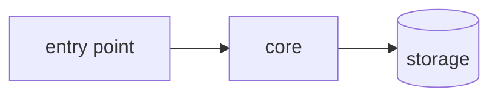

# {{title}}

> [!abstract] TL;DR
> What this codebase does, in two or three sentences. If you cannot write this yet, that is the first thing to work out.

## Why it exists
The problem it solves and who uses it. Skip the marketing, write what you had to figure out.

## How to run it
```bash
# install
# run
# test
```

Minimum path to a working local instance. Note anything you had to guess or install by hand.

## Architecture



One diagram, at the level of "what talks to what". Put detail in the sections below, not in the diagram.

## Map of the code

| Path | What lives here | Start here? |
| --- | --- | --- |
| `src/` | | |
| `src/core/` | | |

## Reading path

Files worth reading in this order to understand the system. Check them off as you go.

- [ ] `path/to/main` [[main]]
- [ ] `path/to/core` [[core]]
- [ ] `path/to/config` [[config]]

## Core concepts

Terms this codebase uses that do not mean what you would assume, or that carry a lot of behaviour.

- **Concept**: where it lives, what it does, and the request that would break it.
- **Concept**: same.

Promote any concept that grows past two sentences into its own note and link it: [[concept]].

## Follow one request

Trace a single real operation from entry to exit. This is usually where the design clicks.

1. Request enters at ...
2. Validated by ...
3. Mutates / reads ...
4. Response leaves at ...

## Patterns worth copying

- ...
- ...

## Gotchas

> [!warning] Traps
> - Things that look wrong but are load-bearing.
> - Ordering dependencies, implicit state, env vars with no defaults.
> - Tests that do not cover what you would expect.

## Open questions

- [ ] ...
- [ ] ...

## Session log

### {{date}}
- Started reading ...
- Learned ...

## Related

- [[...]]
- Repo: https://...

%%
Usage notes (not rendered in reading view):

- Save this file as docs/template.md and point Obsidian's core Templates plugin at the docs folder. New notes get {{title}}, {{date}} and {{time}} filled in automatically.
- Delete sections that do not apply. A note with three filled sections beats one with twelve empty ones.
- Keep frontmatter properties consistent across notes so Dataview or Bases can query them later, e.g. `status` (exploring, understood, stale) and `stack`.
- Link to code with wikilinks only for notes; use backticks for paths so the graph stays about ideas, not files.
%%
